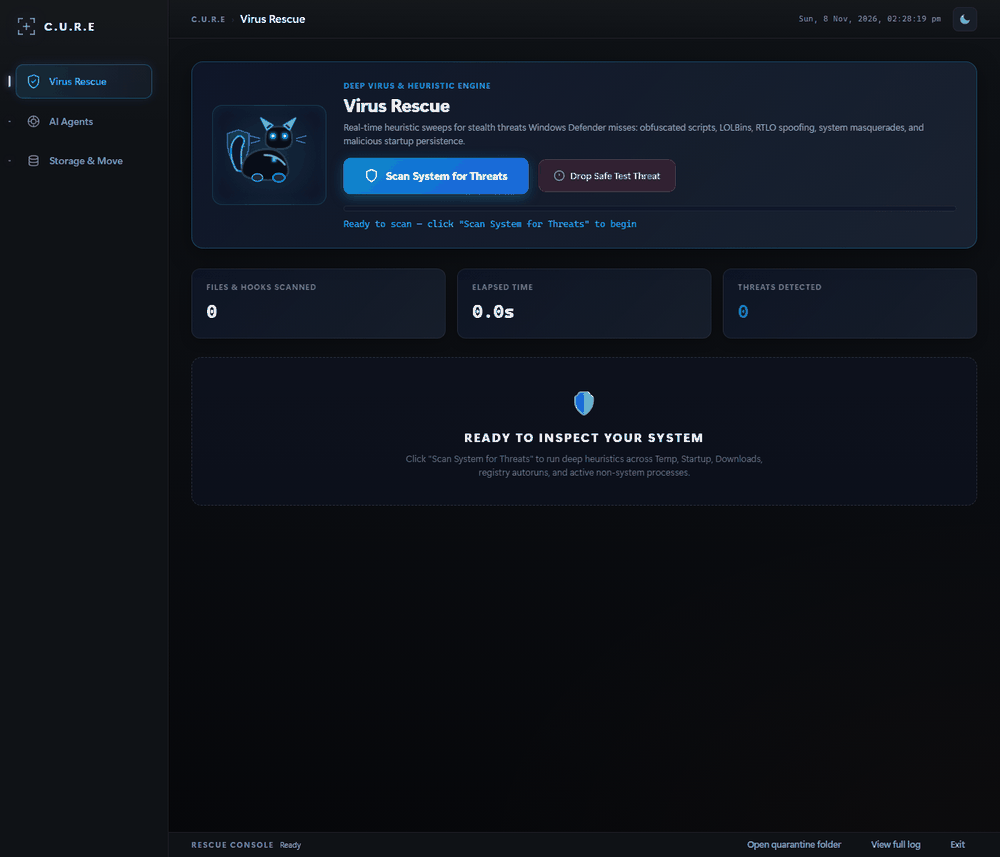

# C.U.R.E — Portable Windows Security & Storage Rescue

> **Evidence-first Windows security console and storage rescue toolkit.**  
> Catches the stealth persistence, script droppers, and LOLBins Windows Defender skips.  
> **100% Offline · Zero Telemetry · Local Heuristic Engine.**

<p align="center">
  <a href="https://github.com/MadB0i/C.U.R.E"></a>
  <a href="https://github.com/MadB0i/C.U.R.E"></a>
  <a href="https://github.com/MadB0i/C.U.R.E"></a>
  <a href="https://github.com/MadB0i/C.U.R.E"></a>
  <a href="https://github.com/MadB0i/C.U.R.E"></a>
  <a href="https://github.com/MadB0i/C.U.R.E"></a>
  <a href="LICENSE"></a>
</p>

---

### 🐾 Watch Cyber-Cat Catch & Swat Stealth Droppers

<p align="center">
  
</p>

> **The Cyber-Cat Companion:** Click *"Drop Safe Test Threat"* to generate a harmless obfuscated dropper in `%TEMP%`. Cyber-Cat's heuristic engine detects it immediately, lets you inspect its MITRE ATT&CK technique and raw evidence, and swats it cleanly into safe quarantine upon confirmation.

---

## ⚡ Why C.U.R.E? (The Reality vs Windows Defender)

Windows Defender is engineered for mass signatures, but frequently ignores local script droppers, encoded execution flags, and obscure boot persistence hooks:

| Threat Category | Windows Defender Default | C.U.R.E Rescue Toolkit |
|:---|:---|:---|
| **Obfuscated Script Droppers** | Misses uncompiled `.vbs`, `.bat`, `.ps1` using encoded strings or download cradles until cloud analysis runs. | **Instant Heuristic Match:** Flags `-EncodedCommand`, `IEX`, WebClient cradles, and RTLO Unicode spoofing immediately. |
| **Living-off-the-Land (LOLBins)** | Allows signed system binaries (`certutil`, `bitsadmin`, `msiexec`) running arbitrary remote URLs. | **Full Argument Scoring:** Resolves and scores execution flags for remote URL fetches and drop zones. |
| **Deep Persistence Hooks** | Scans standard Run keys and common folders; ignores obscure boot vectors. | **10-Surface Inspection:** Registry Run, IFEO debuggers, AppInit DLLs, COM hijacking (TreatAs), Active Setup, WMI & Winlogon. |
| **Remediation Philosophy** | Opaque quarantine or destructive deletion; often breaks system references. | **Move, Never Delete:** Threats are relocated to SHA-256 sealed quarantine with 1-click reversible undo. |
| **AI Agents & Coding Bots** | Blind to running autonomous AI coding tools, token exposure, and memory overhead. | **Dedicated AI Radar:** Detects Antigravity, Claude Code, Cursor, Ollama, groups sibling PIDs, and masks secrets. |
| **Orphaned Storage & App Leftovers** | Built-in Disk Cleanup leaves gigabytes of dead uninstalled program directories and developer caches. | **Storage & Move Engine:** Scans in 2–4s, finds 30+ day abandoned leftovers, and bit-for-bit relocates huge folders (C: → D:). |
| **Data Privacy & Telemetry** | Transmits process telemetry, samples, and diagnostic logs to external cloud servers. | **100% Offline:** Zero network requests, zero telemetry, local LLM/inference safe, SARIF v2.1.0 exports. |

---

## 🖥️ The 3-Workstation Console Architecture

### 1. 🛡️ Page 1: Virus Rescue (`#scan-view`)
- **Cyber-Cat Heuristic Scanner:** Deeply analyzes 10 persistence hooks, Startup folders, Scheduled Tasks with argument inspection, and active processes.
- **Safe Test Dropper:** Test detection capability without downloading real malware.
- **Drop-In Custom Rules Engine:** Drop `.rule` files into `%APPDATA%\cure\rules` with simple pattern rules to catch custom signatures or red-team tools.
- **SARIF v2.1.0 & JSON Export:** Export complete threat audit dossiers directly into standard SARIF for GitHub Code Scanning, Azure DevOps, and security reviews.

### 2. 🤖 Page 2: AI Agents Radar (`#view-agents`)
- **Coding Bot Discovery:** Identifies processes from Antigravity, Claude Code, Cursor, OpenCode, Codex, and local LLMs (Ollama, LM Studio).
- **Process Grouping:** Consolidates multi-process agent instances (e.g. 7 child PIDs) into a single clean telemetry card with memory footprint and port inspection.
- **Strict Evidence Transparency:** Labels processes as Observed or Correlated; never fabricates false causality. Secret tokens and credentials are masked automatically.

### 3. 💾 Page 3: Storage & Move Rescue (`#cleanup-view`)
- **Lightning Drive Discovery:** Identifies the true largest space consumers (`.codex`, `.gradle`, `.android`, `.cache`, `.rustup`, `.lmstudio`, `Downloads`) in 2–4 seconds without hanging on system roots.
- **Uninstalled App Leftovers:** Detects directories belonging to uninstalled applications untouched for 30+ days.
- **Bit-for-Bit Volume Mover:** Safely relocates space-hungry folders from congested drives (C: to D:) with bit-for-bit verification and NTFS junction redirection.

---

## 💻 Terminal Companion (`cure-cli.exe`)

For DevOps engineers, terminal enthusiasts, and CI/CD automated auditing:

```text
   /\_/\   C.U.R.E v0.2.0 [100% Offline · Zero Telemetry]
  ( o.o )  Evidence-First Windows Security & Fast Storage Rescue
   > ^ <   https://github.com/MadB0i/C.U.R.E

startup root : C:\Users\user\AppData\Roaming\Microsoft\Windows\Start Menu\Programs\Startup
common startup: C:\ProgramData\Microsoft\Windows\Start Menu\Programs\Startup
tasks root   : C:\Windows\System32\Tasks
registry     : HKCU + HKLM Run / RunOnce + IFEO + AppInit + COM (HKCU) + WMI + services
custom rules : 2 active rules loaded from %APPDATA%\cure\rules

[HIGH RISK] score= 85  obfuscated_dropper.bat         (startup-folder)  id=a1b2c3d4e5f6
             cmd: cmd.exe /c "powershell -enc aGVsbG8..."
             loc: Startup\obfuscated_dropper.bat
             att&ck: T1059.001 (Command and Scripting Interpreter: PowerShell)
             why [observed]: Base64 encoded payload execution flag
             why [observed]: Custom Rule Match [Encoded PowerShell]: Obfuscated script invocation

summary: 124 entries | 1 high-risk, 0 suspicious, 123 safe | 0 in quarantine
```

### CLI Commands:

```powershell
# Interactive colored system scan with Cyber-Cat banner
cure scan

# Export SARIF v2.1.0 directly for GitHub Actions / CI/CD security scanning
cure scan --format sarif --output results.sarif

# Discover running AI agents and LLM background instances
cure agents

# Inspect storage health and largest consumers
cure storage scan --deep

# Safely quarantine a threat by its ID (reversible)
cure quarantine <id>
cure undo <id>
```

---

## 🧩 Custom Heuristics Engine (`%APPDATA%\cure\rules`)

C.U.R.E allows security researchers, system admins, and developers to write drop-in detection rules. Simply place any `.rule` file in `%APPDATA%\cure\rules`:

```ini
# %APPDATA%\cure\rules\custom_rules.rule
[Rule: Reverse Shell Netcat]
pattern = nc.exe -e cmd.exe
risk = HighRisk
description = Remote cmd reverse shell invocation via netcat

[Rule: Suspicious WebClient Download]
pattern = (New-Object Net.WebClient).Download
risk = HighRisk
description = Obfuscated PowerShell remote payload downloader
```

Rules are hot-loaded on the next scan and flagged with `CUSTOM` ATT&CK designations and observed evidence.

---

## 🛡️ Virus Detection — Proven in a Sealed Sandbox

`testing/native/sandbox-malware-test.py` builds an isolated sandbox, plants industry-standard test threats, runs the **real C.U.R.E engine** against it, asserts detections, and cleans up completely (12/12 checks passing):

| Planted Threat | Engine Result |
|:---|:---|
| **Known-bad hash sample** (live SHA-256 against compiled IOC list) | **HIGH-RISK — "Known Malware Hash"** |
| `certutil -urlcache http://…` downloader (registry Run + task) | **HIGH-RISK (55)** — LOLBIN remote argument |
| Scheduled task: `powershell -w hidden -enc <payload>` | **Detected** — argument scoring |
| Persistence on a UNC network share | **SUSPICIOUS +15** — network share drop zone |
| EICAR test file | Intercepted by host AV before scan (independent proof) |

---

## 🚀 Quick Start

### Prerequisites
- Windows 10 or Windows 11 (64-bit)
- Rust toolchain (`cargo`, `rustc` 1.75+)
- WebView2 Runtime (preinstalled on modern Windows 10/11)

### Build & Run
```powershell
# Clone the repository
git clone https://github.com/MadB0i/C.U.R.E.git
cd CURE

# Launch Desktop GUI (Tauri v2)
cargo run --release --manifest-path gui/src-tauri/Cargo.toml

# Or run the CLI Companion
cargo run --release -p cure_cli -- scan
```

---

## 🧪 Comprehensive Verification Suite

C.U.R.E includes 620+ unit, integration, and sealed-sandbox malware tests:

```powershell
# Run the complete workspace test suite (620+ tests)
cargo test --workspace

# Strict zero-warning linter pass
cargo clippy --workspace --all-targets -- -D warnings
cargo clippy --manifest-path gui/src-tauri/Cargo.toml --all-targets -- -D warnings

# Sealed-sandbox native malware detection verification
python testing/native/sandbox-malware-test.py
```

---

## 📜 Core Principles (Non-Negotiable)

1. **Local Only:** Zero external network calls for scanning. Operates 100% offline.
2. **No Auto-Scan:** Scans initiate strictly upon explicit user command.
3. **Move, Never Delete:** Remediations go to SHA-256 sealed quarantine with complete undo capability.
4. **Honesty Over Comfort:** Inaccessible or unreadable files show as `INCOMPLETE`, never as "clean".
5. **Evidence-First:** Every finding includes explicit evidence provenance (Observed vs Correlated).
6. **Mask Secrets:** API keys, tokens, and credentials are masked automatically.

---

## 📄 License

Distributed under the **MIT License**. See [`LICENSE`](LICENSE) for details.
