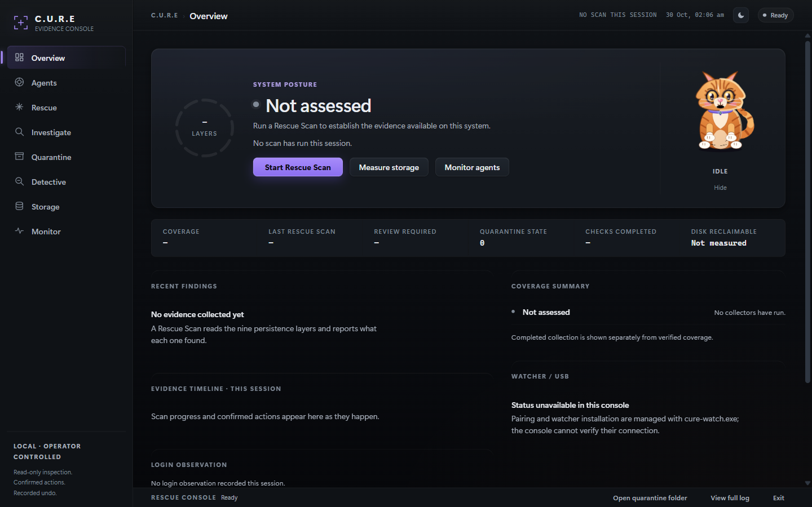
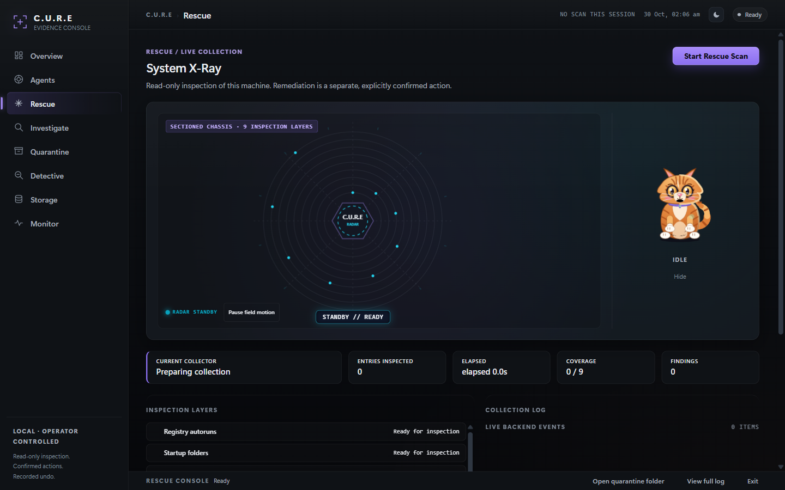
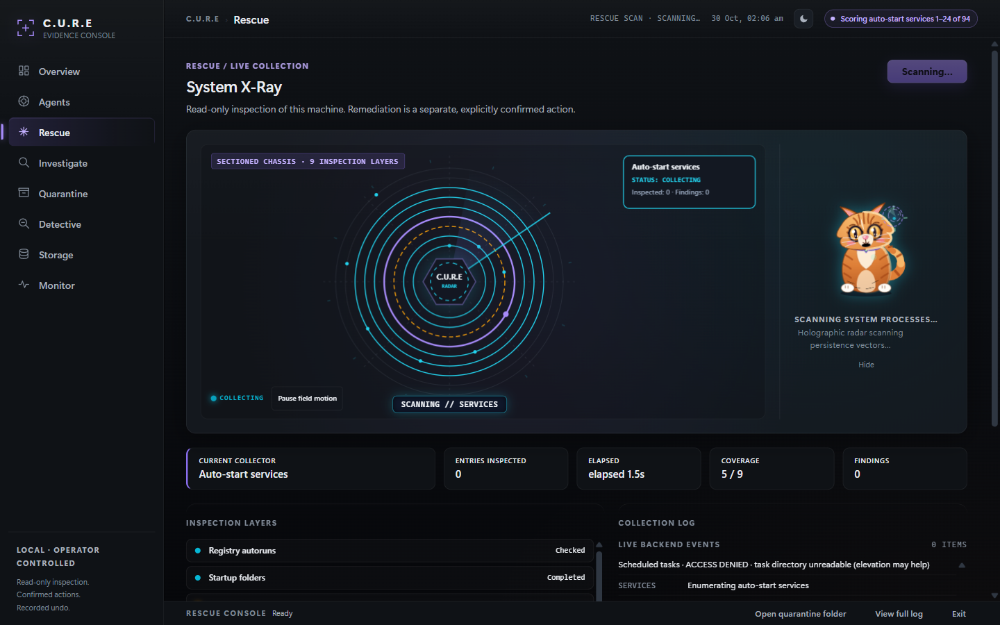
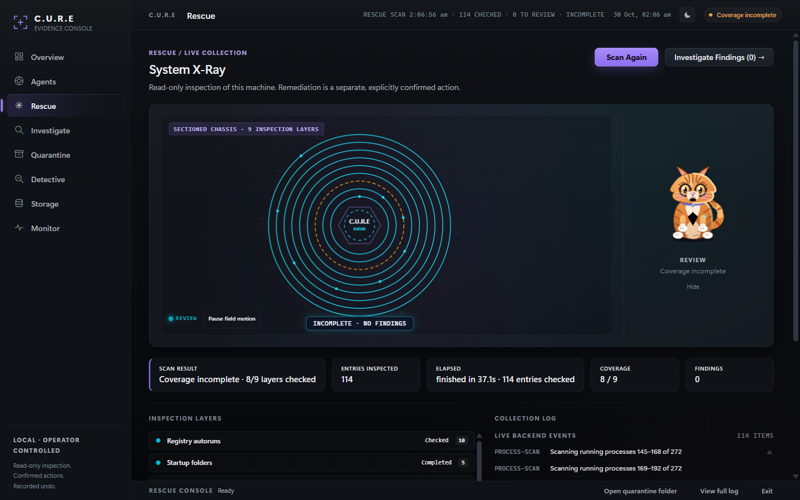
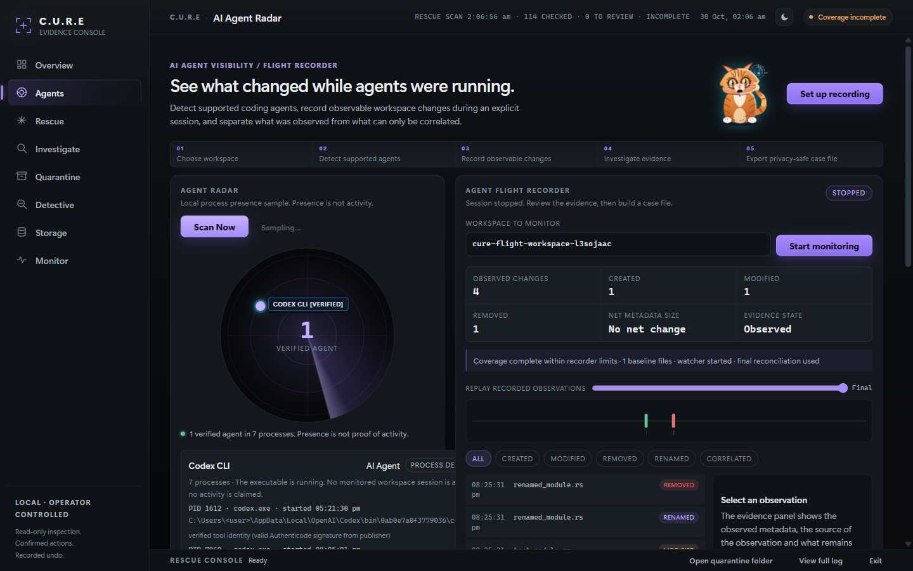
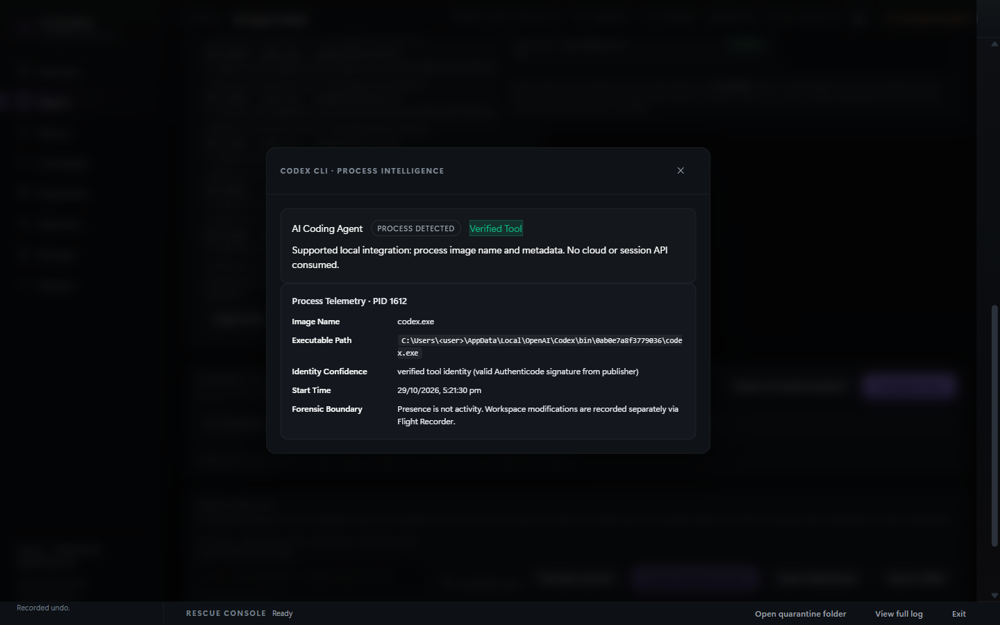
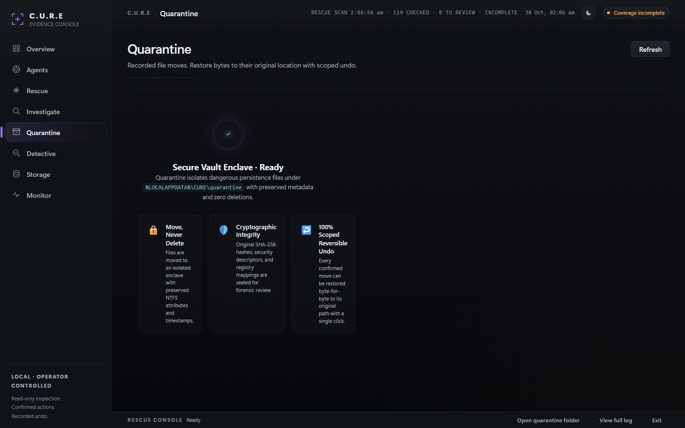
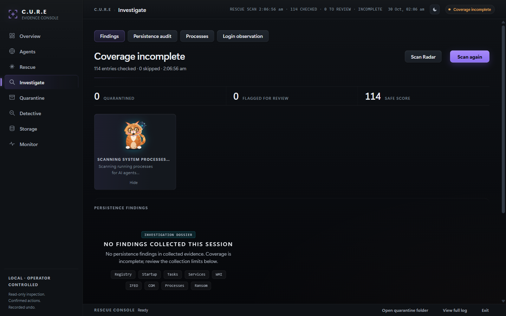

# C.U.R.E

### Evidence-First Windows Security & Storage Workstation with AI Agent Intelligence

C.U.R.E (Clean, Undoable, Resilient, Evidence-first) is a portable Windows cybersecurity toolkit and forensic storage workstation written in Rust with a local Tauri desktop console. It exposes what starts with Windows, discovers and monitors local AI developer agents, explains why entries were flagged, measures physical disk usage, and verifies state before you act.

[](https://github.com/MadB0i/C.U.R.E/actions/workflows/ci.yml)
[](LICENSE)
[](https://github.com/MadB0i/C.U.R.E)
[](https://github.com/MadB0i/C.U.R.E)

---


*Desktop Evidence Console in dark theme featuring LUMA V2 and real-time security posture. (Also available in [light theme](testing/native/screenshots-final/02-overview-light.png)).*

---

## Non-Negotiable Core Principles

1. **Local Only**: Zero telemetry, zero cloud lookups, zero outbound network scanning. Everything executes strictly on your local CPU.
2. **No Auto-Scan**: Scanning commences exclusively from an explicit user action. Non-interactive sessions refuse rather than guess.
3. **Move, Never Delete**: Suspicious items are quarantined to an isolated vault with SHA-256 integrity checks, ACL snapshots, and recorded byte-identical undo.
4. **Honesty Over Comfort**: Incomplete or access-denied areas are highlighted as `INCOMPLETE`, never deceptively certified as "clean".
5. **Evidence-First**: Every finding carries explicit evidence (`Observed`, `Correlated`, `Unknown`). Correlation is strictly distinguished from causation.
6. **Zero Secret Exposure**: Tokens, API keys (`sk-*`), Bearer headers, and credentials found in command lines are automatically masked (`***`) before storage, display, or export.

---

## Visual Tour & Key Capabilities

### 1. Holographic Rescue Scanner
A command-center scanner that probes all 9 supported Windows persistence collectors across concentric orbital rings. Real-time phosphor sweeps report progress, collector states, and evidence beacons without synthetic percentages or fake progress bars.

| Standby Command Center | Real-Time Active Sweep | Post-Scan Evidence Debrief |
| :---: | :---: | :---: |
| [](testing/native/screenshots-final/03-rescue-standby.png) | [](testing/native/screenshots-final/04-rescue-scanning.png) | [](testing/native/screenshots-final/05-rescue-completed.png) |
| *Concentric orbital rings for 9 persistence layers.* | *Active telemetry sweep with collector beacons.* | *Collector completion debrief; never claims "All Clean" if coverage is incomplete.* |

### 2. AI Agent Radar & Flight Recorder
Discovers local AI developer tools running on your workstation—including **OpenCode**, **OpenAI Codex CLI**, **Claude Code**, **Aider**, and local model inference servers like **Ollama**.

- **Authenticode Cryptographic Verification**: Distinguishes genuine signed tools (`Verified`) from unconfirmed executables (`Unverified process`) or renamed binaries (`Suspect binary`). An executable path alone *never* confers verified status without cryptographic proof.
- **Dedicated Model Server Orbit**: Places local inference servers (e.g. Ollama) on an inner blue orbit distinct from autonomous coding agents.
- **Agent Flight Recorder**: Captures a forensic timeline of filesystem events occurring during agent execution. Time correlation is clearly separated from agent causation.

| AI Agent Radar V3 | Native Process Intelligence Inspector |
| :---: | :---: |
| [](testing/native/screenshots-final/06-agent-radar.png) | [](testing/native/screenshots-final/07-agent-inspector.png) |
| *Identifies active agents, candidate processes, and model servers.* | *Deep inspection: Authenticode leaf signer, masked CLI parameters, and PID hierarchy.* |

### 3. LUMA V2 — Anime Cat Companion
An original 2D feline mascot integrated directly into the tactical console. Built with clean SVG vector geometry, LUMA reacts dynamically across 7 operational states (`idle`, `curious`, `scanning`, `success`, `warning`, `sleepy`, `excited`) and equips an animated holographic cyber-HUD visor during active security scans. Complies fully with `prefers-reduced-motion`.

### 4. Secure Quarantine Vault & Persistence Investigation
Remediate detected risks without permanent data loss. Quarantined files are moved into a secure local enclave with full rollback capability. The Investigation Dossier provides deep forensic breakdown of startup shortcuts, tasks, services, and WMI subscriptions.

| Secure Vault Enclave | Investigation Dossier |
| :---: | :---: |
| [](testing/native/screenshots-final/08-quarantine.png) | [](testing/native/screenshots-final/09-investigate.png) |
| *Integrity-checked quarantine with single-click restore.* | *Inspect Run keys, Task scheduler actions, and signature chains.* |

---

## Technical Specifications

### What C.U.R.E Inspects

| Layer | Collector Target | Remediation Policy |
| :--- | :--- | :--- |
| **Registry** | `Run`, `RunOnce`, Policies, Shell Folders | Read-only guidance; registry is never modified directly |
| **Startup** | Startup folders, Shell shortcuts (`.lnk`), `.url` files | Quarantine supported |
| **Tasks** | Windows Task Scheduler actions and triggers | Guidance & payload quarantine |
| **Services** | Windows Service image paths and configurations | Guidance & binary quarantine |
| **WMI** | Permanent Event Consumers and Filter Bindings | Guidance and inspection |
| **IFEO** | Image File Execution Options debuggers / silent hijackers | Guidance and inspection |
| **COM** | Hijackable InProcServer32 and ContextMenu COM registrations | Guidance and inspection |
| **Processes** | Live process tree, PE Authenticode signers, masked CLI args | Inspection & termination guidance |

### Storage Intelligence & Detective Mode
- **Physical Allocation Measurement**: Measures real disk cluster allocation rather than apparent file size.
- **Verified Duplicates**: Computes full SHA-256 digests across both candidates before declaring duplicates.
- **Detective Mode**: "Where did my storage go?" partitions drives into 4 safety tiers:
  - `SAFE TO REVIEW`: Regenerable caches and temporary files.
  - `REVIEW CAREFULLY`: User downloads and project artifacts.
  - `PROTECTED`: Windows system files, drivers, and application runtimes (never touched).
  - `UNKNOWN`: Unclassified paths treated strictly as off-limits.
- **Shareable Case Files**: Exports a cryptographic, privacy-safe summary card with allowlisted metrics, zero usernames, and zero absolute personal paths.

---

## Realistic Safety Limitations & Honest Disclosures

In strict adherence to the **Honesty Over Comfort** principle:

1. **User-Space Forensics (Not a Kernel Driver)**:
   The Flight Recorder relies on standard user-mode directory change notifications (`ReadDirectoryChangesW`) and Win32 process snapshots. It does *not* install a kernel minifilter driver (`fltmgr.sys`) or ETW process I/O tracer. Consequently, filesystem modifications occurring while an agent runs are classified as **Correlated**, never **Attributed**. C.U.R.E reports that an event happened during an agent session; it does not claim the agent caused the write unless cryptographically or handle-proven.
2. **Diagnostic & Rescue (Not an Antivirus or EDR)**:
   C.U.R.E does not provide continuous background real-time interception and will not replace commercial endpoint protection. It is a targeted workstation for inspection, measurement, triage, and clean rollback.
3. **Authenticode Verification & Unsigned Tools**:
   Executable path alone never confers verified status. Legitimate open-source CLI tools compiled from source (e.g. `opencode` built via `cargo install`) will report as `Unverified process` because they lack commercial code-signing certificates.
4. **Offline Revocation**:
   Certificate revocation checking defaults strictly to local cache (`CacheOnly`). If Windows has not locally cached the CRL/OCSP response, status is reported as `ValidRevocationUnknown`. Online network checks require explicit opt-in via `--online-revocation`.
5. **Elevated & Protected Processes (PPL)**:
   Processes protected by Windows Protected Process Light (PPL) or anti-cheat drivers refuse standard query access. C.U.R.E reports them honestly as `AccessDenied` (`Unknown`), never assuming they are clean.

---

## Build and Verify

### Prerequisites
- Windows 10 or 11 (x64)
- Rust (stable toolchain)
- Node.js (v20+ for GUI tests)
- WebView2 runtime (standard on modern Windows)

### Compilation
```powershell
# Build CLI and Watcher binaries
cargo build --release

# Build Desktop GUI binary (cure-gui.exe)
cd gui/src-tauri
cargo build --release
```

### Test Suite & Verification
```powershell
# Run 530+ workspace unit and integration tests
cargo test --workspace

# Strict linter and style verification (zero warnings policy)
cargo clippy --workspace --all-targets -- -D warnings
cargo fmt --check

# GUI offline and syntax verification
pwsh -Command "Get-ChildItem gui/dist/*.js | ForEach-Object { node --check $_.FullName }"
```

---

## Project Structure

```
C.U.R.E/
├── cli/                     # cure.exe CLI scanner and quarantine engine
├── core/                    # Security collectors, Authenticode, risk scoring, storage
│   └── src/agent/           # AI Agent Radar, Flight Recorder, detection & casefiles
├── dirwatch/                # Low-level ReadDirectoryChangesW wrapper
├── gui/                     # Evidence Console desktop application
│   ├── dist/                # Offline, framework-free production frontend
│   ├── dist-demo/           # Deterministic public demo build with mock backend
│   └── src-tauri/           # Tauri desktop wrapper and native IPC commands
├── testing/                 # Synthetic test fixtures and native audit test suites
│   └── native/              # Real desktop automation and native screenshots
├── watch/                   # cure-watch.exe USB monitor service
└── winwatch/                # Windows change detection primitives
```

---

## License

MIT License — see [LICENSE](LICENSE) for details.
