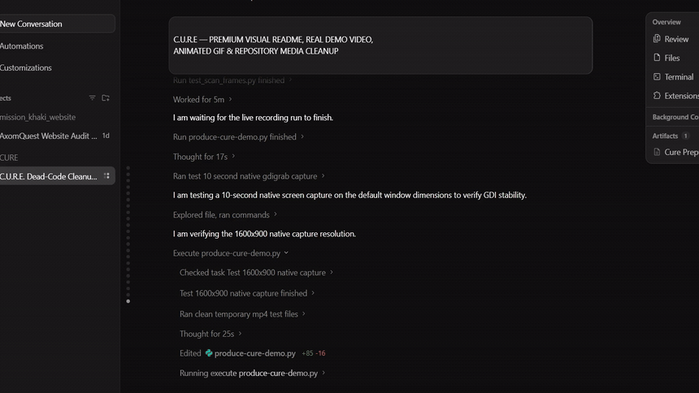
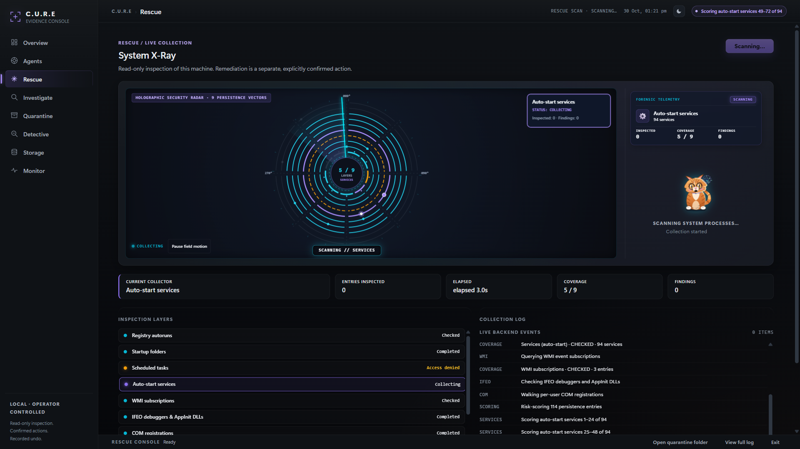

# C.U.R.E

> Evidence-first Windows security toolkit and forensic storage workstation with local AI agent intelligence.

[](https://github.com/MadB0i/C.U.R.E/actions/workflows/ci.yml)
[](https://github.com/MadB0i/C.U.R.E)
[](https://github.com/MadB0i/C.U.R.E)
[](LICENSE)

---

[](docs/media/cure-demo.mp4)

*Real-time holographic sweep and LUMA companion in the native desktop console.*  
**[▶ Watch Full Native Demo Video (1080p MP4, 46s)](docs/media/cure-demo.mp4)**

---

## Visual Tour

| Holographic Rescue Scanner | AI Agent Radar V3 |
| :---: | :---: |
| [](docs/media/cure-rescue-scanner.png) | [](docs/media/cure-agent-radar.png) |
| *Active 9-layer persistence radar with real-time collector telemetry.* | *Identifies local AI developer tools, model servers, and execution hierarchies.* |

| LUMA Tactical Companion | Forensic Investigation Dossier |
| :---: | :---: |
| [](docs/media/cure-overview-luma.png) | [](docs/media/cure-investigation.png) |
| *Dynamic feline console companion with animated cyber-HUD visor.* | *Deep inspection of Run keys, Scheduled Tasks, Services, and WMI subscriptions.* |

---

## Key Capabilities

- **AI Agent Radar V3**: Discovers local AI agents (`OpenCode`, `OpenAI Codex CLI`, `Claude Code`, `Aider`) and model inference servers (`Ollama`). Verifies Authenticode code-signing signatures, distinguishes inner model orbits from autonomous tools, and automatically masks credentials in process arguments.
- **Holographic Rescue Scan**: Inspects all 9 Windows persistence layers (Registry Run, Startup, Tasks, Services, WMI, IFEO, COM, Winlogon, Processes) via concentric orbital collectors with honest status debriefs.
- **Agent Flight Recorder**: Captures a forensic timeline of filesystem changes during agent sessions using Windows directory change notifications (`ReadDirectoryChangesW`).
- **Windows Change Radar**: Tracks persistent system state changes across reboots with point-in-time snapshots and baseline diffing.
- **Shareable Agent Case Files**: Exports cryptographically signed, sanitized incident reports with allowlisted metrics and zero personal usernames or paths.
- **LUMA V2 Companion**: Vector-rendered anime cat mascot responding to 7 operational states (`idle`, `curious`, `scanning`, `success`, `warning`, `sleepy`, `excited`) with a holographic visor during active scans.

---

## Quick Start

### Requirements
- Windows 10 or 11 (x64)
- WebView2 Runtime (standard on modern Windows)

### Run Desktop Console from Source
```powershell
# Clone repository
git clone https://github.com/MadB0i/C.U.R.E.git
cd C.U.R.E

# Run the Tauri desktop Evidence Console
cd gui/src-tauri
cargo run --release
```

### CLI Scanner
```powershell
# Run the command-line scanner directly from the repository root
cargo run --release -p cure_cli -- scan
```

---

## Technical Transparency & Safety

In strict adherence to the **Honesty Over Comfort** principle:

1. **Offline by Default**: Zero outbound telemetry, zero cloud scanning, and zero external API dependencies. WinTrust Authenticode revocation checks default strictly to the local cache.
2. **Move, Never Delete**: Remediation moves flagged items into a SHA-256 integrity-verified quarantine enclave with complete metadata preservation and single-click restoration.
3. **Correlation Is Not Attribution**: The Flight Recorder uses user-mode Windows directory change notifications (`ReadDirectoryChangesW`), not a kernel minifilter driver. Filesystem modifications occurring while an agent runs are classified as **Correlated**, never **Attributed**.
4. **Authenticode Verification**: Executable path alone never confers verified status. Unsigned tools compiled locally report honestly as `Unverified process` rather than masquerading as verified binaries.
5. **Honest Scan Coverage**: Inaccessible directories or denied collectors report `INCOMPLETE`. C.U.R.E never presents an incomplete scan as a clean all-clear.
6. **Credential & Secret Masking**: Detected API tokens (`sk-*`), Bearer headers, passwords, and sensitive CLI parameters are masked (`***`) at capture time before storage, display, or export.

---

## Development & Verification

### Workspace Verification Suite
```powershell
# Run the 530+ workspace unit and integration tests
cargo test --workspace

# Strict formatting and zero-warning linter checks
cargo fmt --check
cargo clippy --workspace --all-targets -- -D warnings

# Validate offline frontend assets
python gui/devtools/make-dev-shell.py
```

### Architecture
```
C.U.R.E/
├── cli/              # cure.exe CLI scanner and quarantine engine
├── core/             # Persistence collectors, Authenticode verification, risk engine
│   └── src/agent/    # AI Agent Radar, Flight Recorder, detection & case files
├── dirwatch/         # ReadDirectoryChangesW change notification engine
├── gui/              # Tauri desktop Evidence Console
│   ├── dist/         # Production offline frontend (HTML5/CSS3/Vanilla JS)
│   ├── dist-demo/    # Byte-identical deterministic demo build
│   └── src-tauri/    # Tauri native application and IPC commands
├── watch/            # cure-watch.exe peripheral & USB security monitor
└── winwatch/         # Win32 change detection primitives
```

---

## License

MIT License — see [LICENSE](LICENSE) for details.
