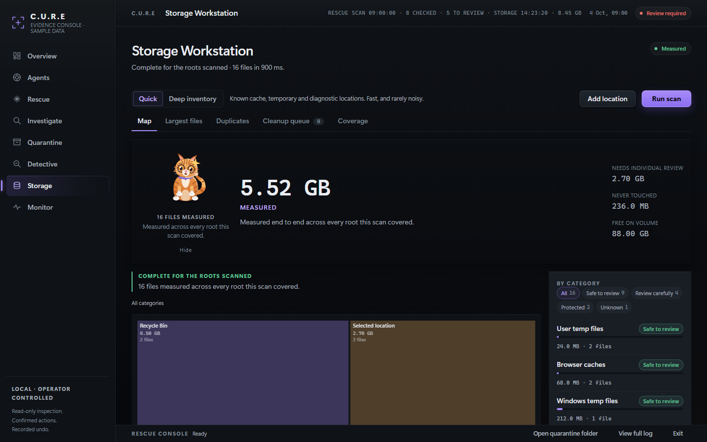
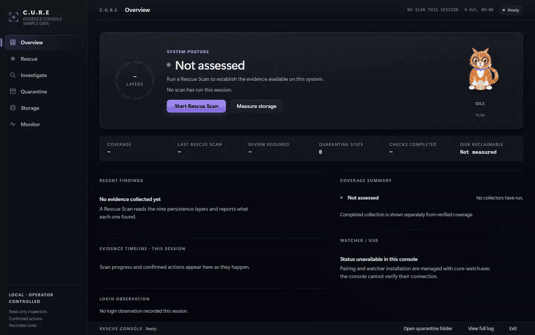
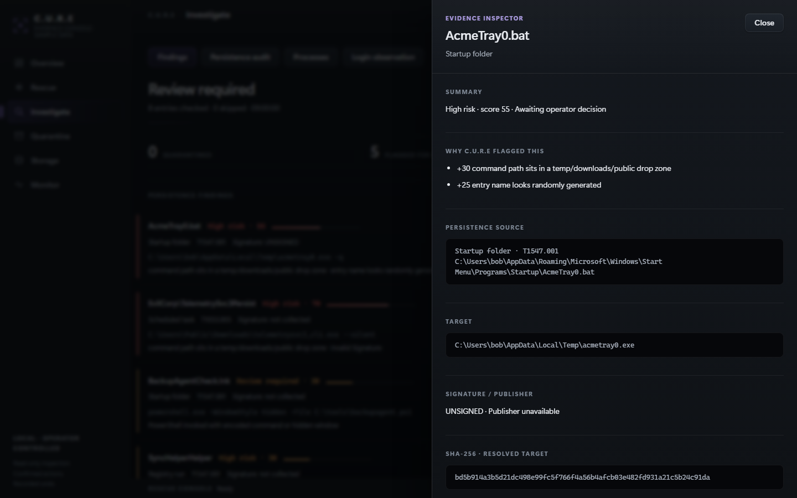
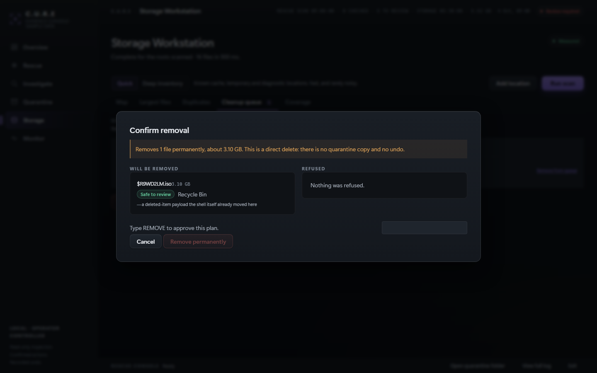
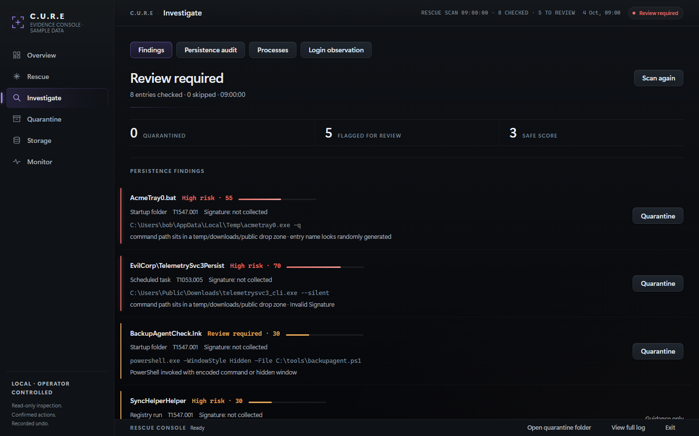

# C.U.R.E

### Evidence-first Windows security and storage workstation.

C.U.R.E shows what starts with Windows, why it was flagged, what is using
your disk, and what will change before you act.

[](https://github.com/MadB0i/C.U.R.E/actions/workflows/ci.yml)



- Inspect Windows persistence points and suspicious processes.
- Review evidence before taking action.
- Quarantine supported files with integrity-checked undo.
- Measure a drive properly, find verified duplicates, and reclaim space
  through a preview you have to type a word to confirm.
- Ask **where did my storage go?** in Detective Mode: a measured map, ranked
  discoveries with their evidence, and a privacy-safe case file you can keep.



[Watch the same flow as MP4](docs/media/demo.mp4)

Malware that survives a reboot hides in startup folders, Run keys, scheduled
tasks, services and WMI subscriptions. C.U.R.E reads those mechanisms, scores
every finding **with its evidence attached**, and moves — never deletes —
files you confirm, with a recorded, byte-identical undo. Anything it will not
touch automatically, such as the registry, is reported as guidance instead.

It also measures storage the way a careful person would: every file with its
real on-disk size, every category with the reasoning that classified it, every
duplicate verified by reading both copies in full, and nothing removed until
you have seen a preview and typed the word.

## What it inspects

| Layer | What C.U.R.E reads |
|---|---|
| Registry | Run/RunOnce keys, Startup folders — **guidance only, never modified** |
| Startup | Startup folders and shortcuts |
| Tasks | Scheduled task definitions and actions |
| Services | Service image paths and descriptions |
| WMI | Event subscriptions and permanent consumers |
| IFEO | Image File Execution Options debugger entries |
| COM | Hijackable COM registrations |
| Processes | Running process list and command lines |

Scoring is heuristic: Authenticode status, path reputation, LOLBin shapes and
local indicators, each with the reason shown beside it. Treat Suspicious and
High as investigation leads, not verdicts.

## What it measures

| Area | What C.U.R.E reports |
|---|---|
| Known-safe caches | User and Windows temp, browser caches, Recycle Bin payloads, crash dumps, diagnostic logs |
| Large files | Every measured file, sorted and filterable, with allocated size rather than apparent size |
| Duplicates | Groups verified by full SHA-256 of every copy, with the copy that would be kept named |
| Downloads | Old installers and archives, always at *review carefully* |
| Developer caches | `node_modules`, `target`, `.nuget`, `.gradle`, build output |
| Large folders | Every folder measured, ranked by the space it occupies |
| Old downloads | Downloads and installers untouched for a long time — labelled by age, never called "unused" |
| Dormant app data | Folders no installed program claims — reported, never offered for deletion |
| Other drives | Any volume or folder you add, with overlapping roots measured once |
| Project output | Build directories recognised wherever they live, including a project on `D:\Projects` |

### Detective Mode

**Detective Mode** answers *where did my storage go?* from the same
measurement the Storage Workstation uses. It runs no second scan and no
filesystem reads: the map partitions the measured bytes, and each ranked
discovery states **what** was found, **where**, **why** it matters, how the
engine **knew**, the **size** on disk, the **risk**, the available
**action**, and **what happens if you act**. Protected and unclassified
storage is never offered for removal, and "dormant" is always labelled a
hint rather than a verdict.

The **case file** is a one-page PNG built from an allowlist. Its model has no
field for a path, a user name, a machine name or a file name, and an
operator note that looks like a path is withheld. A case is only shown as
closed when a receipt from that same scan observed the volume's free space
increase; a removal without that observation stays *review pending*. The
public demo's case file is marked **SYNTHETIC DEMO** and can be previewed but
never written.

### Four tiers, and why "uncertain" is not "probably fine"

`SAFE TO REVIEW` · `REVIEW CAREFULLY` · `PROTECTED` · `UNKNOWN`

* **Safe to review** — regenerable by the program that made it. Files are
  still listed individually before anything is removed.
* **Review carefully** — real files you or an application created. Selectable
  one at a time; never a bulk action.
* **Protected** — Windows, drivers, recovery, restore points, installed
  applications. Never proposed, never removed.
* **Unknown** — the engine could not classify the path. Treated as
  off-limits. Uncertainty escalates; it never resolves downward into a delete.

"Potentially unused" does not mean "safe to delete". A folder no file has
touched in a year may hold a licence, the only copy of something, or the state
of an application you use daily. C.U.R.E says so next to the number.

## Screenshots

| | |
|---|---|
|  |  |
| **Storage Workstation** — measured first, removed only after you confirm. | **Evidence inspector** — why it was flagged, and what it points at. |
|  |  |
| **Cleanup queue** — protected and uncertain files have no action at all. | **Review required** — every finding carries its score and reason. |

All screenshots and demo media use labelled mock sample data. Numbers in them
are invented for the harness and were never measured on a real machine.

## Download

[**Releases**](https://github.com/MadB0i/C.U.R.E/releases/latest)

Each release carries:

| File | What it is |
|---|---|
| `C.U.R.E-Setup.exe` | Windows installer (NSIS), installs for the current user |
| `cure-gui.exe` | Desktop Evidence Console (Tauri, needs WebView2) |
| `cure.exe` | CLI scanner, quarantine and undo |
| `cure-watch.exe` | USB watcher: consent, pairing, launch, uninstall |
| portable ZIP | The above, no installer |
| `SHA256SUMS.txt` | Hashes for the archive contents |

Windows 10/11 with WebView2 (preinstalled on current Windows).

**The binaries are unsigned.** Windows shows a SmartScreen warning on first
run. The installer installs for the current user, needs no administrator
rights, **does not disable antivirus or bypass Windows security warnings**,
and **does not install the USB watcher** — that is a separate, explicit act.

No administrator rights are needed for the core flows; unelevated scans show
INCOMPLETE rows instead of guessing.

```bat
cure.exe --data-dir .\cure-data scan
cure.exe --data-dir .\cure-data quarantine <id>     :: asks first
cure.exe --data-dir .\cure-data undo <id>

:: Storage measurement. Read-only: this never removes anything.
cure.exe storage scan --depth quick
cure.exe storage scan --depth deep --abandoned
cure.exe storage duplicates --root D:\Media
cure.exe storage bench --files 20000 --size 4096 --copies 4
```

## Safety and limitations

**C.U.R.E is a diagnostic and rescue tool. It is not an antivirus or an EDR.**
It does not guarantee malware detection, provides no real-time protection, and
will not make an infected machine safe on its own.

- **Nothing runs without you.** No auto-scan: every run starts with one
  explicit click or command. Non-interactive sessions refuse rather than guess.
- **Local only.** No telemetry, no accounts, no cloud lookups. Certificate
  revocation is cache-only unless you pass `--online-revocation`. Cloud-only
  files are never downloaded while scanning.
- **Move, never delete — for anything suspicious.** Quarantine relocates with
  size and hash integrity checks, snapshots ACLs, and restores
  byte-identical — or reports exactly what could not be restored.
- **Storage cleanup is the one permanent deletion**, and it is guarded: it
  requires a current scan, a preview of every item with the consequences in
  plain language, a typed confirmation word, and a re-validation of every
  target immediately before it is removed. Anything that moved, changed
  size, became a link, left its authorised root, or changed tier is refused
  and listed on the receipt.
- **Never touch.** `C:\Windows` outside named cleanable subtrees, `WinSxS`,
  `DriverStore`, `Installer`, `System32\config`, `System Volume Information`,
  recovery partitions, restore locations, `Program Files`, `ProgramData` and
  the Recycle Bin's own index records are never proposed for removal.
- **Honest gaps.** Areas that could not be read render as INCOMPLETE, never as
  "clean". If any location was unreadable the headline reads *at least*
  rather than a total.
- **Last-access timestamps are not evidence.** Windows frequently disables
  them. C.U.R.E records them and never reasons from them.
- **Scoring is heuristic.** Novel attacker patterns outside the known list can
  score Safe. `%VAR%` expansion depends on the process environment.
- **Same-user code execution is out of scope.** Stopping malware already
  running as your user is not enforced by any user-space scanner.

## Build and validate

```bat
cargo build --release        :: cure.exe + cure-watch.exe
cd gui\src-tauri
cargo build --release        :: cure-gui.exe

cargo test --workspace
cargo clippy --workspace --all-targets -- -D warnings
cargo fmt --check
```

The GUI ships an offline, framework-free frontend and has deterministic
state, accessibility, keyboard, layout, reduced-motion and pixel checks that
use mock data and change nothing on the host:

```powershell
python -m pip install -r gui/devtools/requirements.txt
python -m playwright install chromium
cd gui/devtools
npm ci && npm test && npm run layout && npm run pixel
```

And there is a **native** end-to-end check that drives the real release
binary through the real WebView2 webview and the real Rust backend over the
DevTools protocol. It covers startup, navigation, a real storage scan with
real progress, coverage, cancellation, the preview, the confirmation, the
removal and the receipt, the Detective board reading that same measurement,
the case-file privacy audit, the companion's twelve states, reduced motion
and the keyboard route. The only file it ever removes is one it created itself,
inside a directory it created itself, inside the system temporary
directory:

```powershell
cargo build --release --manifest-path gui/src-tauri/Cargo.toml
python testing/native/native-e2e.py
```

## Documentation

[Changelog](docs/CHANGELOG.md) ·
[Architecture](docs/ARCHITECTURE.md) ·
[Storage benchmarks](docs/benchmarks/storage-engine.md) ·
[Release notes](docs/RELEASE-NOTES-0.2.0.md) ·
[Release readiness](docs/RELEASE-READINESS-0.2.0.md) ·
[Visual verification](docs/UI-REDESIGN-VERIFICATION.md) ·
[GUI verification](gui/devtools/README.md) ·
[Real-PC validation report](docs/validation/REAL-PC-VALIDATION.md) ·
[Manual test checklist](testing/real-pc/README-TESTING.md) ·
[Companion verification](docs/LUMA-COMPANION-VERIFICATION.md) ·
[Security policy](SECURITY.md)

## License

MIT — see [LICENSE](LICENSE).