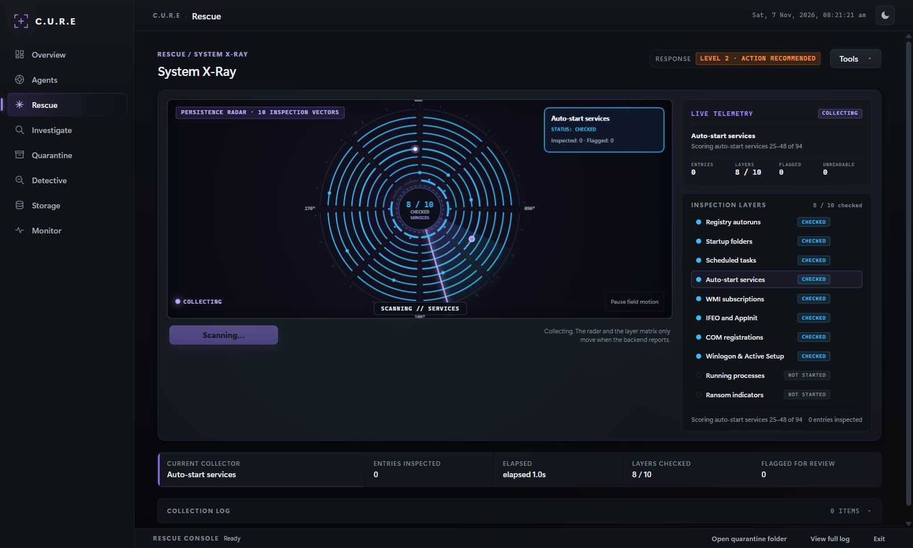
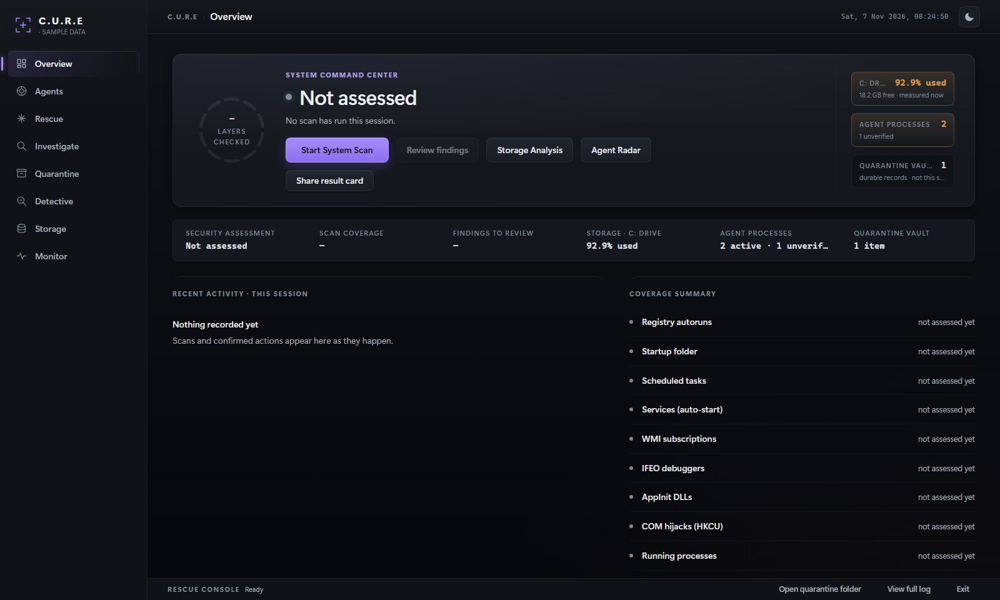
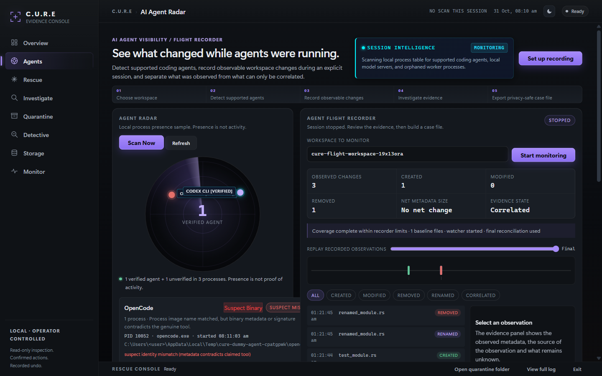
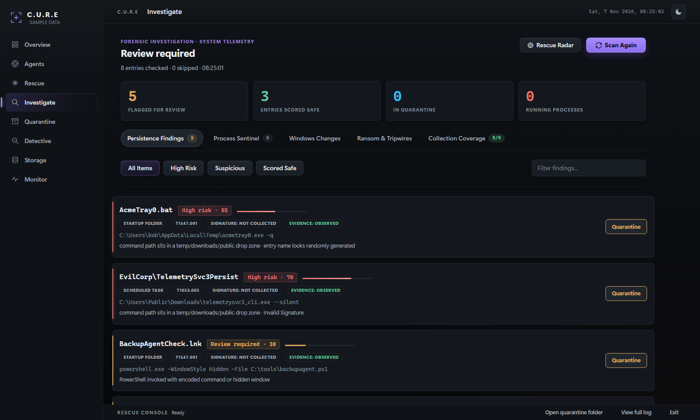
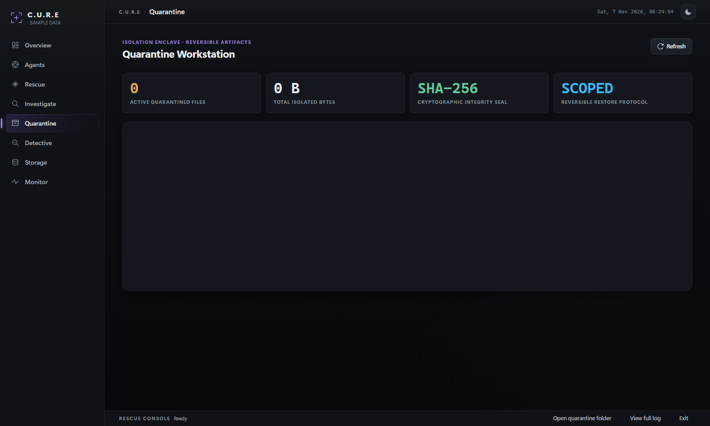
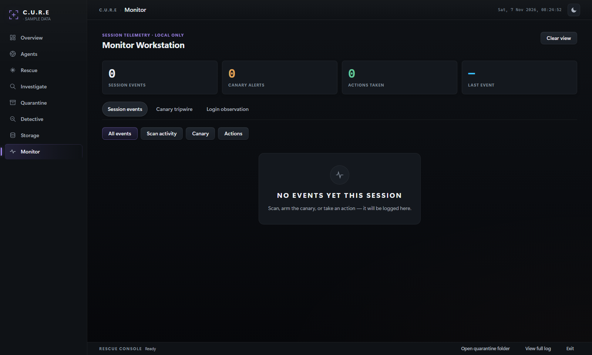
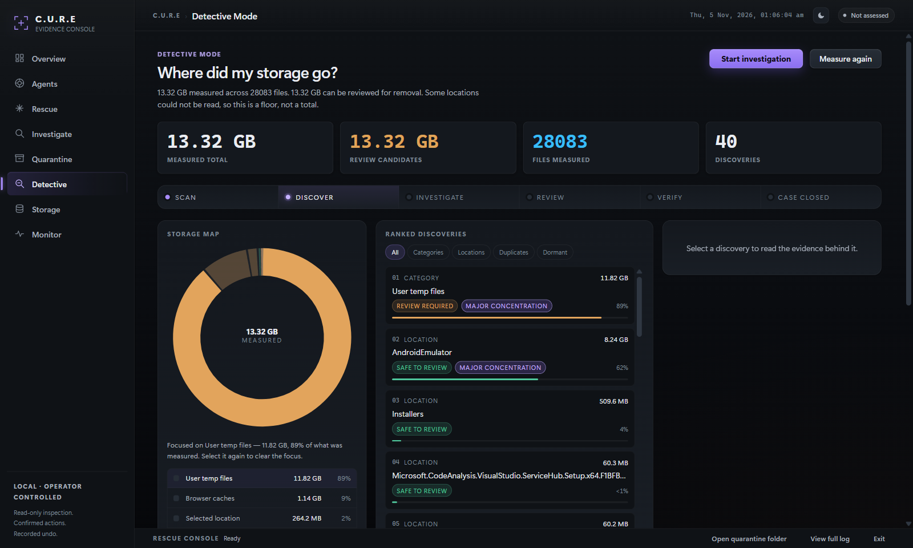

# C.U.R.E

> Evidence-first Windows security console and forensic storage workstation.
> Local only. No telemetry. No auto-scan. Move, never delete.

[](https://github.com/MadB0i/C.U.R.E/actions/workflows/ci.yml)
[](https://github.com/MadB0i/C.U.R.E)
[](https://github.com/MadB0i/C.U.R.E)
[](LICENSE)

---

[](docs/media/cure-hero.png)

*C.U.R.E inspects a Windows machine for persistence, suspicious activity and
reclaimable storage, and reports what it found with the evidence attached. It
never changes anything without an explicit, previewed confirmation.*

---

## Visual Tour

| Overview | AI Agent Radar |
| :---: | :---: |
| [](docs/media/cure-overview.png) | [](docs/media/cure-agents.png) |
| *One posture, nine inspection layers, real operator tiles.* | *Identifies local AI coding agents and model servers, verifies signatures, masks secrets.* |

| Investigation Console | Quarantine Workstation |
| :---: | :---: |
| [](docs/media/cure-investigate.png) | [](docs/media/cure-quarantine.png) |
| *Five forensic lenses over the same collected evidence — findings, processes, Windows changes, ransom indicators, coverage.* | *Reversible isolation enclave with SHA-256 integrity seals and 1-click scoped undo.* |

| Monitor Workstation | Detective Mode |
| :---: | :---: |
| [](docs/media/cure-monitor.png) | [](docs/media/cure-detective.png) |
| *Session telemetry, canary tripwire, and the post-login Observation Chamber.* | *Read-only storage forensics: where the bytes went, what can be reviewed.* |

---

## Key Capabilities

- **Ten-surface persistence scan** — Registry autoruns, Startup folders, Scheduled
  Tasks (arguments included), Services, WMI subscriptions, IFEO, AppInit, COM
  registrations, Winlogon/Active Setup and running processes, each scored with
  ATT&CK mapping and the evidence attached. Script-cradle arguments
  (`IEX`, `DownloadString`, encoded payloads), network-share persistence and
  the LOLBins Defender trusts (`certutil`, `bitsadmin`, `msiexec`) are scored
  even when the binary is signed.
- **Investigation Console** — five forensic lenses (Findings, Process Sentinel,
  Windows Change Radar, Ransom indicators, Collection coverage) over one collected
  evidence set, with sanitized JSON/TXT report export.
- **Quarantine Workstation** — flagged items are *moved, never deleted*, into an
  integrity-sealed enclave with preserved NTFS metadata and scoped one-click undo.
- **Monitor Workstation** — a live session event feed with kind filters, the
  experimental **Canary tripwire** (decoy files watched for tampering and
  bulk-encryption patterns), and the **Login Observation chamber**: a bounded
  15/30/60/120 s window that correlates what actually starts with recorded
  startup persistence (DIRECT / STRONG / PARTIAL / WEAK — deterministic levels,
  never a verdict).
- **AI agent intelligence** — Agent Radar enumerates local AI coding agents and
  model servers (Authenticode-verified, secrets masked at capture), the Flight
  Recorder records filesystem changes during agent sessions via
  `ReadDirectoryChangesW`, and Case Files export signed, sanitized dossiers.
  The same surface exists on the CLI: `cure agents`, `cure change`,
  `cure recorder`, `cure casefile`.
- **Storage forensics** — the Storage Workstation measures, ranks and (only after
  an explicit, previewed confirmation) reclaims space; Detective Mode explains
  where the bytes went. The CLI's `storage` surface is read-only by design.
- **Share result card** — one click builds a PNG with aggregate counts only
  (findings, flagged processes, canary alerts, actions). No paths, no names, no
  secrets. You preview the exact file before it is saved.

---

## Quick Start

### Requirements
- Windows 10 or 11 (x64)
- WebView2 Runtime (standard on modern Windows)
- [Rust](https://rustup.rs) (stable) to build from source

### Run the desktop console from source
```powershell
git clone https://github.com/MadB0i/C.U.R.E.git
cd C.U.R.E\gui\src-tauri
cargo run --release
```

### Or use the CLI
```powershell
# From the repository root
cargo run --release -p cure_cli -- scan                  # persistence scan
cargo run --release -p cure_cli -- report --format json  # sanitized report
cargo run --release -p cure_cli -- incident --duration 30
cargo run --release -p cure_cli -- agents                # AI agent radar
cargo run --release -p cure_cli -- storage scan          # read-only storage intel
```

Every list the console shows handles loading, empty, error and INCOMPLETE states
honestly. Areas the engine could not read are reported as INCOMPLETE — never as
"clean".

---

## Technical Transparency & Safety

In strict adherence to the **Honesty Over Comfort** principle:

1. **Offline by default**: zero outbound telemetry, zero cloud scanning, zero
   external API dependencies. Revocation checks default strictly to the local cache.
2. **No auto-scan**: collection starts only from an explicit click or command.
3. **Move, never delete**: remediation moves flagged items into a SHA-256
   integrity-verified quarantine with complete metadata preservation and scoped undo.
4. **Correlation is not attribution**: Flight Recorder events are classified as
   **Correlated**, never attributed, and correlation levels never claim intent.
5. **Honest scan coverage**: inaccessible areas report `INCOMPLETE`. C.U.R.E never
   presents an incomplete scan as an all-clear.
6. **Secrets are masked, never stored**: detected API tokens, Bearer headers and
   credentials are masked at capture time before storage, display or export.

---

## Development & Verification

```powershell
# 590+ workspace unit and integration tests
cargo test --workspace

# Strict formatting and zero-warning lints (root workspace + GUI crate)
cargo fmt --check
cargo clippy --workspace --all-targets -- -D warnings

# Per-stage native UI acceptance (drives the real cure-gui.exe over CDP)
python gui/devtools/ui06-native-verify.py
python gui/devtools/ui07-native-verify.py
```

### Architecture
```
C.U.R.E/
├── cli/              # cure.exe CLI: scan, diff, quarantine, incident, agents, change, recorder, casefile
├── core/             # Persistence collectors, signature & risk engine, canary, incident
│   └── src/agent/    # AI agent detection, Flight Recorder sessions, case files
├── watch/            # cure-watch.exe background USB/peripheral monitor (opt-in)
├── winwatch/         # cure_dirwatch: ReadDirectoryChangesW guard & recorder engine
├── gui/              # Tauri desktop Evidence Console
│   ├── dist/         # Production offline frontend (HTML/CSS/vanilla JS, no framework)
│   ├── dist-demo/    # Deterministic demo build (mock backend, never touches the machine)
│   └── src-tauri/    # Tauri v2 native application and IPC commands
├── testing/          # Native CDP harnesses, fixtures, real-PC validation kit
└── tools/            # Demo frontend generator, audits
```

### Honest limitations
- Windows-only (x64), user mode. No kernel/ETW tracing — filesystem events stay
  **Correlated**, never attributed.
- Scheduled Task XML inspection needs elevation; denied areas are shown as
  INCOMPLETE, not skipped silently.
- A second simultaneous scan is refused by design (no cancellation support in the
  backend yet).
- The canary tripwire is a tripwire, not ransomware protection.

---

## License

MIT License — see [LICENSE](LICENSE) for details.
